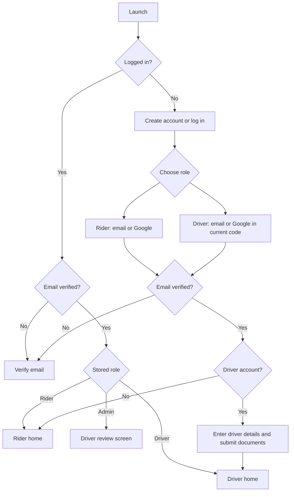
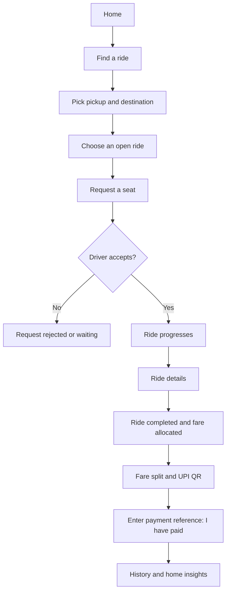
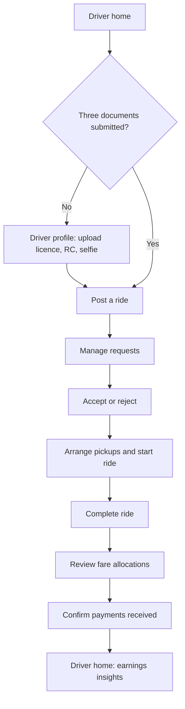
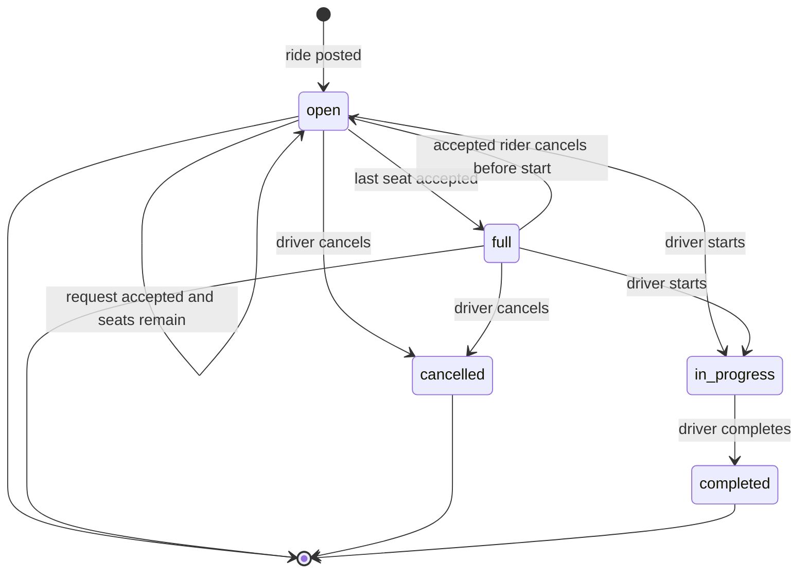
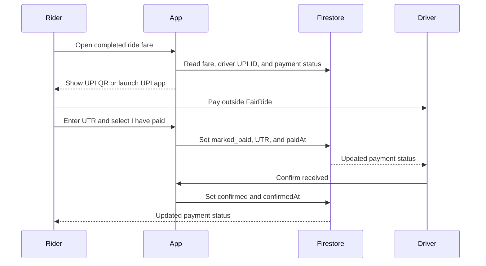
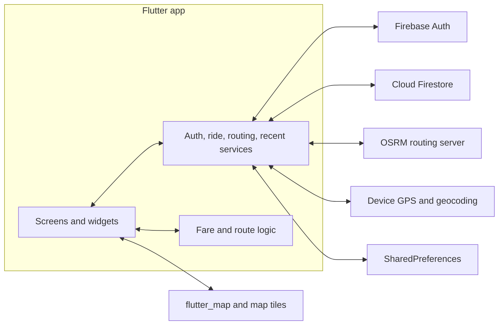
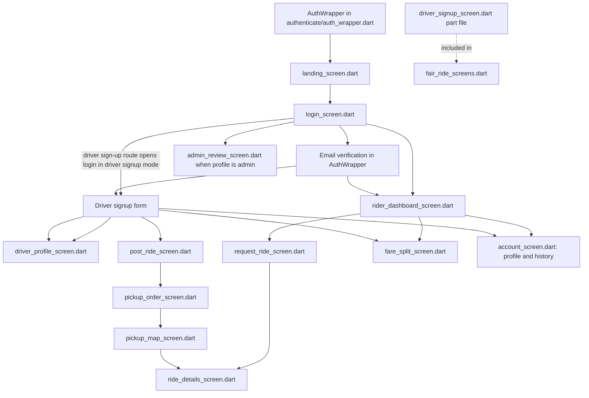
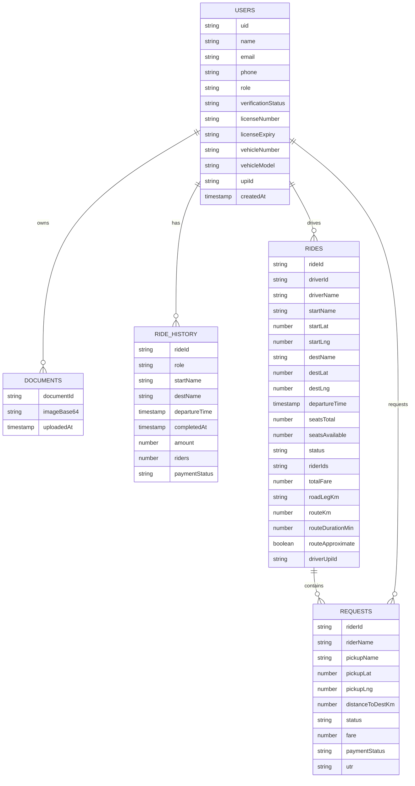
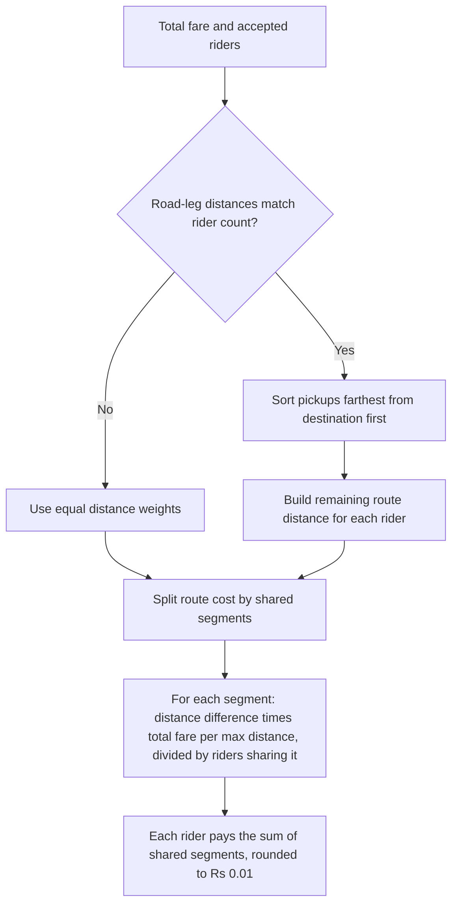

# FairRide

FairRide is a Flutter campus carpool app that helps riders find shared rides and drivers coordinate pickups, fares, and payments.

## Android debug APK

[Download the FairRide Android debug APK](https://github.com/KoenaBiswas/FairRide/releases/download/v1.0.0-android-debug-2026-11-24/FairRide-android-debug.apk).


## Problem and idea

Students traveling across campus and nearby areas may have overlapping trips but no simple way to share seats and costs. FairRide lets a driver post a route and available seats, lets riders request to join, and records the ride and fare allocation in Firebase. Payments are made outside the app through UPI; FairRide records a rider-submitted reference and the driver's confirmation.

## Contents

- [Feature list](#feature-list)
- [User flow](#user-flow)
- [Diagrams](#diagrams)
- [Technology stack](#technology-stack)
- [Architecture and source layout](#architecture-and-source-layout)
- [Firestore data model](#firestore-data-model)
- [Firestore security rules](#firestore-security-rules)
- [Setup and run](#setup-and-run)
- [Android debug APK](#android-debug-apk)
- [Test data](#test-data)
- [Known limitations and future work](#known-limitations-and-future-work)
- [Team and course](#team-and-course)

## Feature list

Each row describes behavior found in this repository. The Rider and Driver columns indicate who can use it. Screen links below refer to files under `fairride/lib/`.

### Authentication and accounts

| Feature | Rider | Driver | Where in code |
|---|---|---|---|
| Email and password sign-up and login | Yes | Yes | `authenticate/auth_service.dart`, `screens/login_screen.dart` |
| Google sign-in | Available when Google is configured; the login form passes its selected role for new accounts | Also selectable in the current login form; Google is not restricted to riders in this code | `authenticate/auth_service.dart`, `screens/login_screen.dart` |
| Email verification gate | Yes | Yes | `authenticate/auth_service.dart`, `authenticate/auth_wrapper.dart` |
| Role selection and role check at login | Rider role | Driver role | `screens/login_screen.dart`, `authenticate/auth_service.dart` |
| One role per account | A stored profile has one `role`; sign-in rejects a mismatched selected role | Same | `authenticate/auth_service.dart`, `authenticate/auth_wrapper.dart` |
| Logout | Signs out Firebase Auth; Google provider sign-out is not explicitly called | Same | `authenticate/auth_service.dart`, `fair_ride_widgets.dart` |

### Driver onboarding

| Feature | Rider | Driver | Where in code |
|---|---|---|---|
| Driver profile fields: licence number and expiry, vehicle model and number, UPI ID | — | Yes | `screens/login_screen.dart`, `screens/driver_profile_screen.dart`, `authenticate/auth_service.dart` |
| Upload licence, vehicle RC, and selfie images to Firestore as compressed Base64 image data | — | Yes | `screens/driver_profile_screen.dart`, `authenticate/auth_service.dart` |
| Submit all three documents before posting a ride | — | Required by app logic | `services/ride_service.dart` (`createRide`) |
| Admin review UI exists, but its approval is not required by the app's document gate; Firestore rules permit posting status `pending_review` or `verified` | — | Yes | `screens/admin_review_screen.dart`, `services/ride_service.dart`, `../firestore.rules` |

### Rides

| Feature | Rider | Driver | Where in code |
|---|---|---|---|
| Find open rides with available seats | Yes | — | `screens/request_ride_screen.dart`, `services/ride_service.dart` |
| Post a ride with origin, destination, departure time, seats, and total fare | — | Yes | `screens/post_ride_screen.dart`, `services/ride_service.dart` |
| Request a seat and cancel a pending or accepted request (before ride start) | Yes | — | `screens/request_ride_screen.dart`, `services/ride_service.dart` |
| Accept or reject a rider request | — | Yes | `screens/pickup_order_screen.dart`, `services/ride_service.dart` |
| Live Firestore updates for ride/request views; accepted seat counts are changed transactionally | Yes | Yes | `services/ride_service.dart` |
| Arrange pickup order, mark pickup, start and complete a ride, or cancel a ride | View ride | Yes | `screens/pickup_order_screen.dart`, `screens/pickup_map_screen.dart`, `services/ride_service.dart` |
| View previous ride history | Yes | Yes | `screens/account_screen.dart`, `services/ride_service.dart` |

### Maps and routing

| Feature | Rider | Driver | Where in code |
|---|---|---|---|
| Map display and location selection using `flutter_map` | Yes | Yes | `screens/ride_details_screen.dart`, `screens/pickup_map_screen.dart`, `widgets/location_picker_field.dart` |
| OSRM driving route and approximate straight-line fallback | Ride route details | Pickup route before starting | `services/routing_service.dart`, `screens/ride_details_screen.dart`, `screens/pickup_order_screen.dart` |
| Place search with short address labels and device geocoder fallback | Yes | Yes | `widgets/location_picker_field.dart` |
| Pick a point on a map and use current device location | Yes | Yes | `screens/pickup_map_screen.dart`, `widgets/location_picker_field.dart` |

### Fare and payments

| Feature | Rider | Driver | Where in code |
|---|---|---|---|
| Fare calculator: equal split and distance-based allocation across shared route legs | Yes | Yes | `logic/fare_calculator.dart`, `screens/fare_split_screen.dart` |
| Display fare amounts in rupees | Yes | Yes | `utils/currency.dart`, ride and fare screens |
| Pay through a UPI app link or display a UPI QR code | Yes | Supplies UPI ID | `screens/fare_split_screen.dart` |
| Enter “I have paid” with a UTR/payment reference | Yes | Sees payment status | `screens/fare_split_screen.dart`, `services/ride_service.dart` |
| Driver “Confirm received” updates payment status | — | Yes | `screens/fare_split_screen.dart`, `services/ride_service.dart` |
| Payment status recorded as unpaid, marked paid, or confirmed | Yes | Yes | `models/ride_models.dart`, `services/ride_service.dart` |

### Home pages and analytics

| Feature | Rider | Driver | Where in code |
|---|---|---|---|
| Role-specific home page with upcoming/completed ride summaries | Yes | Yes | `screens/rider_dashboard_screen.dart` |
| Home insights for spending, completed rides, savings and frequent route | Yes | — | `screens/account_screen.dart` (`FairRideHomeInsights`) |
| Home insights for earnings, completed rides, riders carried and monthly totals | — | Yes | `screens/account_screen.dart` (`FairRideHomeInsights`) |
| Monthly chart | Yes | Yes | `screens/account_screen.dart` (`FairRideHomeInsights`) |

### Navigation and profile

| Feature | Rider | Driver | Where in code |
|---|---|---|---|
| Side drawer with profile, previous rides, previous transactions, and logout | Yes | Yes | `screens/account_screen.dart`, `fair_ride_widgets.dart` |
| Driver profile and documents/UPI editor | — | Yes | `screens/driver_profile_screen.dart` |
| Bottom navigation: Home, Find ride, Fare split | Yes | — | `fair_ride_widgets.dart` |
| Bottom navigation: Home and Post ride | — | Yes | `fair_ride_widgets.dart` |
| Ride details view | Yes | Yes | `screens/ride_details_screen.dart` |

### Convenience

| Feature | Rider | Driver | Where in code |
|---|---|---|---|
| System keyboard autofill hints for form fields | Yes | Yes | `fair_ride_widgets.dart`, `screens/login_screen.dart` |
| Recent email, phone, and place suggestions | Yes | Yes | `services/recent_store.dart`, `screens/login_screen.dart`, `widgets/location_picker_field.dart` |
| Remember last selected role and post-ride seat/fare defaults | Yes | Yes | `services/recent_store.dart` |
| Prefill a Google profile's name and email; additional profile fields can be completed in the UI | Yes | Yes, if chosen as new Google role | `authenticate/auth_service.dart`, `screens/login_screen.dart` |
| “Use my current location”; local store also provides a method to clear saved suggestions (no screen action is wired to it) | Yes | Yes | `widgets/location_picker_field.dart`, `services/recent_store.dart` |
| App does not persist passwords in SharedPreferences or Firestore | Yes | Yes | `services/recent_store.dart`; authentication is handled by Firebase Auth |

### Security and scope

| Feature | Rider | Driver | Where in code |
|---|---|---|---|
| Firestore rules source file for user, document, history, ride, and request access | Yes | Yes | [`firestore.rules`](firestore.rules) |
| Demo seed data can add synthetic ride/request examples for the signed-in role | Yes | Yes | `services/ride_service.dart` (`seedDemoData`) |
| Live driver GPS tracking and AI features | Not implemented | Not implemented | Future work |

## User flow

### Authentication



Google sign-in creates a profile using the selected role if none exists. The current UI makes Google sign-in available for either selected role; the diagram reflects the code rather than a rider-only restriction.

### Rider journey



### Driver journey



### Ride lifecycle



Request documents separately use `pending`, `accepted`, `rejected`, `picked_up`, `dropped`, and `cancelled`.

### Payment sequence



## Diagrams

### System architecture



### Screen navigation map



`driver_signup_screen.dart` exists as a part file; the registered `/driver-signup` route currently opens `FairRideLoginScreen` with driver sign-up selected, so the driver signup UI is rendered by `login_screen.dart`. `pickup_order_screen.dart` manages a ride's requests and offers the pickup map; `account_screen.dart` also contains profile, history, and insight widgets.

### Firestore data model



Collections are `users/{uid}`, `users/{uid}/documents/{documentId}`, `users/{uid}/rideHistory/{rideId}`, `rides/{rideId}`, and `rides/{rideId}/requests/{riderUid}`. The code has no `live` collection or separate live-location document. Fields are written according to each record's role and lifecycle, so optional fields such as `riders`, `paymentStatus`, and route fields may be absent until relevant.

### Fare split logic



For the worked example in `logic/fare_calculator.dart`, distances of 10 km, 6 km, and 2 km with a total fare of Rs 100 produce Rs 66.67, Rs 26.67, and Rs 6.67 respectively. If the recorded road-leg list does not match the rider count, the code falls back to equal weights. The fare calculator does not use straight-line distance when a valid road-leg list is available.

## Technology stack

Direct dependency constraints below are copied from `fairride/pubspec.yaml`.

| Technology | Version constraint | Use |
|---|---:|---|
| Flutter SDK | SDK dependency | Mobile app UI |
| Firebase Auth (`firebase_auth`) | `^7.1.0` | Email/password, Google credential, verification, sessions |
| Firebase Core (`firebase_core`) | `^5.2.0` | Firebase initialization |
| Cloud Firestore (`cloud_firestore`) | `^7.2.0` | Profiles, documents, rides, requests, history |
| `flutter_map` | `^8.3.2` | Map presentation and selection |
| OSRM | Public routing endpoint; no package version | Road routes and distance/duration legs |
| `geolocator` | `^14.0.3` | Device location |
| `geocoding` | `^5.0.0` | Address-to-coordinate fallback and labels |
| `shared_preferences` | `^2.5.3` | Local recent suggestions and defaults |
| `qr_flutter` | `^4.1.0` | UPI QR display |
| `google_sign_in` | `^7.2.0` | Google account authentication |
| `latlong2` | `^0.10.1` | Geographic coordinates and distance helpers |
| `url_launcher` | `^6.3.3` | Launch UPI payment URI |
| `image_picker` / `image` | `^1.1.2` / `^4.5.4` | Capture/select and compress document images |
| `http` | `^1.2.2` | OSRM and place-search requests |

## Architecture and source layout

The Flutter package is in `fairride/`; Firebase rules are at the outer repository root. `main.dart` initializes Firebase and opens `FairRideApp`. `AuthWrapper` listens to Firebase Auth and the user's Firestore profile, then selects the landing, verification, rider, driver, or admin screen. Screens call `RideService` for Firestore reads/writes, `RoutingService` for routes, and `RecentStore` for device-local suggestions. Ride completion calls `fare_calculator.dart` and writes each allocated fare to the request and history records.

```text
fairride/lib/
├── README.md                         This project guide
├── main.dart                         Firebase initialization and app entry point
├── fair_ride_screens.dart            App root, route table, imports, and screen library
├── fair_ride_theme.dart              Shared color palette and Material theme
├── fair_ride_widgets.dart            Shared forms, cards, navigation, and account drawer helpers
├── firebase_options.dart             Android Firebase client options
├── authenticate/
│   ├── auth_service.dart             Firebase Auth, profile creation, role checks, sign-in/out
│   ├── auth_widgets.dart             Authentication form controls and validators
│   └── auth_wrapper.dart              Auth state, verification gate, and role-based screen routing
├── logic/
│   ├── fair_ride_plan.dart           Ride-plan helper logic
│   ├── fare_calculator.dart          Fare allocation by distance/shared route segments
│   ├── rider_ordering.dart           Pickup ordering and coordinate distance helpers
│   └── route_filter.dart             Rider pickup-to-route proximity filtering
├── models/
│   └── ride_models.dart              Ride, request, history records and status values
├── screens/
│   ├── account_screen.dart           Drawer, rider profile, ride history, and analytics widgets
│   ├── admin_review_screen.dart      Admin driver document review interface
│   ├── driver_profile_screen.dart    Driver profile, document upload, UPI, history
│   ├── driver_signup_screen.dart     Driver signup screen part declaration
│   ├── fare_split_screen.dart        Fare allocation, UPI payment, and ride selection
│   ├── landing_screen.dart           Signed-out landing screen
│   ├── login_screen.dart             Login, signup, role selection, and Google sign-in UI
│   ├── pickup_map_screen.dart        Map of the route and ordered pickups
│   ├── pickup_order_screen.dart      Driver request management and ride progress controls
│   ├── post_ride_screen.dart         Driver ride-posting form
│   ├── request_ride_screen.dart      Rider ride search and seat requests
│   ├── ride_details_screen.dart      Ride route, status, riders, and fare details
│   └── rider_dashboard_screen.dart   Rider and driver home screens
├── services/
│   ├── recent_store.dart             Local recent values and ride defaults
│   ├── ride_service.dart             Firestore ride, request, seat, payment, and history operations
│   └── routing_service.dart          OSRM road routing and approximate fallback
├── utils/
│   ├── currency.dart                 Rupee formatting
│   └── license_number.dart           Licence number validation helpers
└── widgets/
    └── location_picker_field.dart    Place search, current location, map pin, and recent places
```

The screen files in `screens/` are Dart `part` files included by `fair_ride_screens.dart` (except standalone `pickup_map_screen.dart`), rather than independent libraries. `fair_ride_screens.dart` is the route registry. Some screens are opened through `MaterialPageRoute` in addition to named routes.

## Firestore data model

| Path | Main fields used by the app |
|---|---|
| `users/{uid}` | `uid`, `name`, `email`, `phone`, `role`, `verificationStatus`, `createdAt`; driver profiles also use `licenseNumber`, `licenseExpiry`, `vehicleNumber`, `vehicleModel`, `upiId`; admin UI/rules use `isAdmin` and review fields |
| `users/{uid}/documents/{documentId}` | `imageBase64`, `uploadedAt`; document IDs are `licence`, `rc`, and `selfie` |
| `users/{uid}/rideHistory/{rideId}` | `rideId`, `role`, `startName`, `destName`, `departureTime`, `completedAt`, `amount`; driver history also stores `riders`; rider payment updates may store `paymentStatus` |
| `rides/{rideId}` | `driverId`, `driverName`, vehicle and driver UPI snapshot, start/destination names and coordinates, `departureTime`, `seatsTotal`, `seatsAvailable`, `status`, `riderIds`, `totalFare`, timestamps; start adds `roadLegKm`, `routeKm`, `routeDurationMin`, `routeApproximate`; completion adds `completedAt` |
| `rides/{rideId}/requests/{riderUid}` | `riderId`, `riderName`, pickup name/coordinates, `distanceToDestKm`, `status`, `fare`, `paymentStatus`, `utr`, `paymentMethod`, and lifecycle timestamps |

The model/status classes are in `fairride/lib/models/ride_models.dart`; write paths are in `fairride/lib/services/ride_service.dart`. No separate `live` subcollection is implemented. Rider/driver location is not streamed to another user during a ride.

## Firestore security rules

`firestore.rules` permits a signed-in user to create/read/update their own profile subject to role and verification-status checks; users can read/write their own document subcollection, and a signed-in user can write ride history. Signed-in users can read rides and read/write request documents. Ride creation is limited to the signed-in driver whose `driverId` matches and whose user profile has `verificationStatus` of `pending_review` or `verified`. Ride updates and request writes are broadly allowed to any signed-in user by the current rules; review these rules before using a production Firebase project.

The rules file is source code only. Paste its contents into Firebase Console → Firestore Database → Rules and publish them (or deploy with a configured Firebase CLI). Committing `firestore.rules` to Git does not publish it to Firebase.

## Setup and run

### Prerequisites

- Flutter SDK with a Dart SDK satisfying the constraint `^3.13.7` in `fairride/pubspec.yaml`.
- Android Studio/Android SDK or another supported Flutter toolchain; Android is the configured target.
- A Firebase project with Email/Password and Google providers enabled, and Cloud Firestore created.
- An Android emulator or device. Internet access is needed for Firebase, place search, OSRM, and map tiles; location and camera permissions are requested for the corresponding actions.

### Configure and launch

```powershell
git clone <repository-url>
cd <repository-folder>\fairride
flutter pub get
```

Register an Android app in Firebase using the application ID `com.example.fairride` from `android/app/build.gradle.kts`. Place the downloaded `google-services.json` at `fairride/android/app/google-services.json`. The repository currently contains an Android `google-services.json` and Android-only `lib/firebase_options.dart`; for another Firebase project, replace/regenerate both with that project's configuration. iOS options are not configured in `firebase_options.dart`.

For Google sign-in on Android, add the SHA-1 signing fingerprint for each developer's build key to the Android app in Firebase Project Settings, then download the updated `google-services.json`. To view the local Gradle signing report:

```powershell
cd android
.\gradlew signingReport
cd ..
```

Paste and publish the repository's `firestore.rules` in the Firebase console as described above. Then run:

```powershell
flutter run
```

To run static analysis from the Flutter package directory:

```powershell
flutter analyze
```

## Test data

`RideService.seedDemoData()` creates repeatable synthetic rides and requests for the signed-in rider or driver; it does not create fake driver accounts or seed UPI IDs. For any manually created fake test-driver profile, use a clearly non-production UPI ID in the `*.test@...` form. Never use real driving-licence or vehicle-registration (RC) photos for testing; use synthetic images instead. UPI payments are external and should not be sent during tests.

## Known limitations and future work

- Driver documents are stored as compressed images in Firestore; there is an admin review screen, but the app's post-ride document gate does not require an administrator to approve them. The current Firestore rules accept `pending_review` for ride creation.
- An account stores one role; there is no in-app role switching for an existing profile.
- OSRM and place search use public demo/search services that can be rate limited or unavailable. Routing falls back to a straight-line estimate marked approximate.
- Live/background driver location tracking is not implemented.
- UPI QR/link support only opens an external payment flow and records rider-entered references plus driver confirmation; there is no payment gateway or automatic bank-transfer verification.
- Google sign-in is currently available for either selected role in the login UI; restricting it to rider accounts would require an app-code change.
- Android is configured in the checked-in Firebase options; iOS and web Firebase configuration are not present.

Future work includes background live tracking, integration with a real payment gateway, and stronger document verification and Firestore authorization.

## Team and course

FairRide is a five-person Mobile Computing lab project at Indira Gandhi Delhi Technical University for Women (IGDTUW).

- Jyoti Soni
- Kavya Chaudhari
- Koena Biswas
- Lavanaya Khosla
- Manasvi


